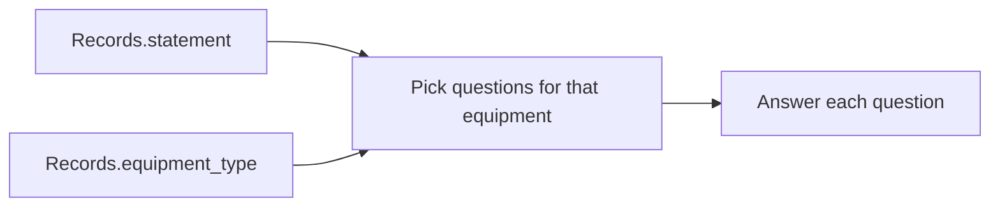

# Functional Specification — nimble_plant

| | |
|---|---|
| Control file | [`nimble_classifier_workbook.xlsx`](../nimble_classifier_workbook.xlsx) |
| Program | [`nimble_runner.py`](../nimble_runner.py) |
| Engines | **Nimble** (local), **Jev** (TypeSafe), **JevK5** (local open-weight) — same question pack, same answer forms |
| How to run | [`../README.md`](../README.md) |

---

## 1. Real use case (start here)

Everything begins with one plant **statement**.

On the **Records** sheet that is the column named `statement` (column **D** in the current workbook: A=`record_id`, B=`equipment_type`, C=`tag`, D=`statement`). Config key `record_statement_column` points at that header; the program reads by **name**, not by letter.

That same row also carries **`equipment_type`** (Pump, Heat Exchanger, Distillation Column) and usually a **tag**. The statement is already classified **under** that equipment type: the sheet says *what kind of asset* the note is about. The engines do not invent the equipment class; they answer questions scoped by it.

Then the program uses the statement to **figure things out** — not by inventing free prose, but by answering the active rows on **Questions**:

| question_id | Kind | Type | Scope |
|---|---|---|---|
| `failure_mode` | common | choice | Labels differ by equipment |
| `containment` | common | noul | all |
| `load` | common | score | all (low / normal / high) |
| `urgency` | common | score | all (routine / soon / immediate) |
| `impact` | common | score | all (none / degraded / severe) |
| `potential_impact` | common | score | all (low / moderate / high) |
| `cross_contamination` | unit-op | noul | Heat Exchanger only |
| `off_spec` | unit-op | noul | Distillation Column only |
| `stability` | unit-op | score | Distillation Column only |

So the industry loop is:

**statement → equipment type → applicable questions → structured answers**

Nimble, Jev, and JevK5 are engines that can run that same loop. The spreadsheet defines *what* to ask; the program builds the query; the engine returns the answers.



---

## 2. What “figuring things out” means

For one statement the runner does not ask “tell me about this pump.” It asks the **Questions** sheet — only the rows that apply to this equipment.

| Kind | On Questions sheet | When it runs |
|---|---|---|
| **Common** | `equipment_type` left blank | Every statement (any equipment) |
| **Unit-op** | `equipment_type` set (e.g. Heat Exchanger) | Only when the record’s equipment matches |

**Labels** hold the allowed answers for categories and scales. The same common question (e.g. failure mode) can use **different label catalogs per equipment** so a pump is not offered “fouling” and an exchanger is not offered “seal.”

That is the classification algorithm: the statement is the input; equipment type selects the question pack; each question returns one structured field.

---

## 3. Three answer forms (how answers come back)

Every question is one of three types. That is what Nimble/Jev know how to score.

| Type | Meaning | Spreadsheet source | Example |
|---|---|---|---|
| **choice** | Pick one category | Labels for that question (optionally per equipment) | failure mode → `seal`, `fouling`, … |
| **noul** | Yes / no | No labels | containment loss → true/false |
| **score** | Place on an ordered scale | Labels in `order` (low → high) | urgency → `routine` / `soon` / `immediate` |

There is no free-form essay output. The Results sheet is one row per statement × question: human title, answer, confidence.

---

## 4. Spreadsheet ↔ program connection

The workbook **is** the spec of the classifier. The program reads sheets; it does not invent the taxonomy.

| Sheet | Role |
|---|---|
| **Read Me** | In-workbook editing rules (same model as this doc). |
| **Records** | One row = one case. `statement` = the plant note. Also `equipment_type`, `tag`. |
| **Questions** | What to figure out: `question_id`, `title`, `type` (`choice`/`noul`/`score`), `instructions`, optional `equipment_type`, `active` (Y/N). |
| **Labels** | Allowed answers / score levels (`label`, `description`, `order`); may be scoped by `equipment_type`. |
| **Config** | Defaults (`engine`, timeouts, review threshold, `record_statement_column`, …). CLI `--engine` still overrides. Keep `api_key` blank. |
| **output_\<engine\>_Results** | Long format: one row per statement × question (`statement`, `question_id`, `title`, `answer`, …). Engines: `nimble`, `jev`, `jevk5`. |
| **output_\<engine\>_Raw / Summary / Run_info** | Raw JSON, per-question stats, run metadata (no API key stored). |
| **output_compare** | Same statements side by side for every engine that has Results (2+). |

For each Records row the program:

1. Takes the **statement** and **equipment_type**.
2. Selects active Questions that are common or match that equipment.
3. Attaches Labels (filtered by equipment where set).
4. Sends one `/v1/systemone` body: `state` = statement, `questions` = the typed pack.
5. Writes answers back to Results.

```json
{
  "model": "<nimble | jev-… | alibiserikbay/JevK5>",
  "state": "<Records.statement>",
  "questions": {
    "<question_id>": {
      "type": "choice | noul | score",
      "instructions": "…",
      "criteria": "…"
    }
  }
}
```

Same body shape for every engine. Only base URL, model name, and auth differ.

---

## 5. Why several engines exist

| | Nimble | Jev | JevK5 |
|---|---|---|---|
| Where | Local Ollama | TypeSafe cloud | Local [JevK5 runtime](https://github.com/allebee/jevk5) |
| Model | `nimble` | `jev-1.13.0` | `alibiserikbay/JevK5` |
| Auth | none | `TYPESAFE_API_KEY` | none |
| Contract | `/v1/systemone` | `/v1/systemone` | `/v1/systemone` |
| Default URL | `http://localhost:11434` | `https://api.typesafe.ai` | `http://localhost:8090` |

Run any combination on the **same** statements and question pack; use `output_compare` when two or more Results exist. That is how we judge engines without changing the industry method.

JevK5 must use the decision readout (not chat/vLLM). On small GPUs use GGUF + [`scripts/jevk5_gguf_serve.py`](../scripts/jevk5_gguf_serve.py) on `:8090`; on larger GPUs use upstream `jevk5-serve`.

---

## 6. Requirements (short)

| ID | Requirement |
|---|---|
| FR-1 | Input to classify is the Records **`statement`** column (currently column D). |
| FR-2 | Each statement is under an `equipment_type`; that selects which questions run. |
| FR-3 | Questions are common (blank equipment) or unit-op scoped. |
| FR-4 | Every question is only `choice`, `noul`, or `score`. |
| FR-5 | Labels may differ by equipment under one shared `question_id`. |
| FR-6 | Engines share one request contract; Results are long-format (one row per answer). |
| FR-7 | Secrets stay in the environment — never in the workbook. |

---

## 7. Acceptance (does the use case work?)

| Check | Pass |
|---|---|
| Statement in | Every Results path can be traced to a Records statement. |
| Equipment scopes work | Pump and exchanger both get common fields; exchanger-only / column-only questions do not leak to the wrong class. |
| Three forms | Choice → a Labels value; noul → true/false; score → a Labels level. |
| Multi engine | Same workbook, same statements, Nimble / Jev / JevK5, optional compare. |

---

## 8. Related documents

| Document | Role |
|---|---|
| [`../README.md`](../README.md) | Install, engines, how to run |
| [`../operations_maintenance_use_cases.md`](../operations_maintenance_use_cases.md) | Plant O&M use cases for the classifiers |
| Workbook **Read Me** | In-Excel editing rules |
| [`../scripts/jevk5_gguf_serve.py`](../scripts/jevk5_gguf_serve.py) | JevK5 GGUF `/v1/systemone` wrapper for small GPUs |
